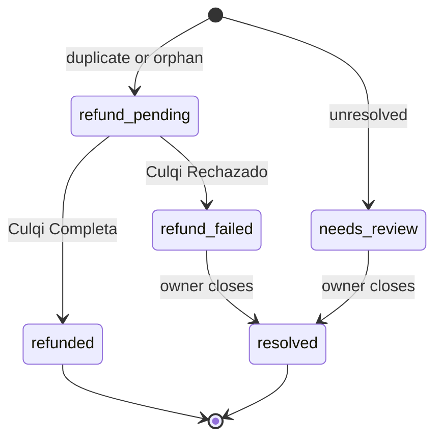

# culqi module

The culqi module stores the records of the Culqi reconciliation job: charges without an order, duplicate charges, and charges the job cannot resolve ([ADR 0005](../adr/0005-culqi-payments.md), decision 15). F1: `PendingReconciliation` and the `ReconciliationLog` port. It does not own payments, payment sessions, captures or refunds: those are Payment Module data, written through the Culqi payment provider. It does not call Culqi: the job does, through the Culqi client in `src/lib/culqi`. Money follows [ADR 0001](../adr/0001-money-representation.md): `bigNumber` in major units plus lowercase `currency_code`. The client converts Culqi's integer céntimos and uppercase `PEN` at its boundary.

| Unit | Path | Data |
|---|---|---|
| Payment provider `culqi` (`pp_culqi_culqi`) | `src/modules/culqi-payment` | No models. It keeps what it needs in the payment session `data` (ADR 0005, decision 9), which Medusa owns and the storefront can read |
| Module `culqi` | `src/modules/culqi` | `culqi_reconciliation` |
| Culqi client | `src/lib/culqi` | None |

## Models

Medusa adds `created_at`, `updated_at` and `deleted_at` to every data model; soft delete sets `deleted_at` ([Data model properties](https://docs.medusajs.com/learn/fundamentals/data-models/properties)). The tables below leave them out. Every ID uses `model.id({ prefix })` ([id property](https://docs.medusajs.com/resources/references/data-model/property-types/id)). Unique indexes are partial, `where deleted_at` is null ([Indexes](https://docs.medusajs.com/learn/fundamentals/data-models/index)).

### `culqi_reconciliation` (ID prefix `culrec`)

One successful Culqi charge the job could not match to an order's payment. One record per charge.

| Field | Type | Constraints | Notes |
|---|---|---|---|
| `id` | `id` | primary key | |
| `charge_id` | `text` | unique; check `^chr_` | The unique index keeps the job idempotent: a rerun finds the record and only re-checks it |
| `session_id` | `text` | not blank | Medusa payment session, from the charge's `metadata.medusa_session_id` |
| `cart_id` | `text` | nullable; set unless `kind` is `unresolved` (check) | Resolved from the session or `metadata.medusa_cart_id` |
| `order_id` | `text` | nullable; set only for `duplicate` (check) (proposed) | The cart's order, paid by another charge |
| `amount` | `bigNumber` | > 0 | Charge amount in major units |
| `currency_code` | `text` | lowercase; check `^[a-z]{3}$` | `pen` |
| `kind` | `enum` | `duplicate`, `orphan`, `unresolved` | ADR 0005, decision 15, step 3. `matched` charges get no record. Labels (admin): "Cobro duplicado", "Cobro sin pedido", "Sin resolver" |
| `status` | `enum` | see below | |
| `refund_id` | `text` | nullable; check `^ref_`; set once; null for `unresolved` (check) | Culqi refund of the full amount |
| `charge_created_at` | `dateTime` | | Culqi's creation time. The 30-minute grace period counts from it (proposed) |
| `resolved_at` | `dateTime` | nullable | The owner closed the record |
| `resolved_by` | `text` | nullable; set with `resolved_at` (check) | Admin user ID |
| `resolution_note` | `text` | nullable; not blank; set with `resolved_at` (check) | What the owner did |

`created_at`, listed in ADR 0005, is Medusa's implicit column: when the job wrote the record.

Status (proposed):

| Status | Label (admin) | Holds when | Open |
|---|---|---|---|
| `refund_pending` | "Reembolso en proceso" | `duplicate` or `orphan`: the refund was asked for and Culqi answered `Pendiente`, or the call has not answered yet | Yes |
| `refunded` | "Reembolsado" | Culqi answered `Completa` | No |
| `refund_failed` | "Reembolso rechazado" | Culqi answered `Rechazado` | Yes |
| `needs_review` | "Por revisar" | `unresolved`: never refunded automatically | Yes |
| `resolved` | "Resuelto" | The owner closed a `refund_failed` or `needs_review` record | No |

Culqi statuses are compared case-insensitively (ADR 0005, decision 11). "Open" is what `findByCart` returns: while a cart has an open record, the storefront shows "Estamos confirmando tu pago" and "No vuelvas a pagar: revisaremos tu pago y te escribiremos a tu correo." (ADR 0005, decision 14).

The record holds no personal data: no email, no card data, no Culqi decline codes.

## Module links

None (proposed). The record keeps plain IDs (`cart_id`, `session_id`, `order_id`):

- It must exist when the cart or session cannot be found (`unresolved`).
- One job writes it, and the store route reads it by `cart_id`. No `query.graph` call needs to join it.

The payment provider has no models and no links. Whether a module provider can own data models: Not verified; F3 spike (ADR 0005, decision 2). This design does not need it.

## Service operations

The port other code calls. Generated CRUD methods follow the service factory names ([list method](https://docs.medusajs.com/resources/service-factory-reference/methods/list)).

- `recordCharge(input)`: creates the record with status `refund_pending` or `needs_review` by `kind`, or returns the existing one for that `charge_id`.
- `recordRefund(id, { refund_id, culqi_status })`: sets `refund_id` and maps the status: `Completa` → `refunded`, `Pendiente` → stays `refund_pending`, `Rechazado` → `refund_failed`.
- `listPendingRefunds()`: `refund_pending` records with a `refund_id`, which the job re-checks with `GET /v2/refunds/{id}`.
- `listStuck(olderThan)`: `refund_pending` records without `refund_id` after a run. The job alerts the owner instead of refunding again (proposed).
- `findOpenByCart(cart_id)`: the latest open record of the cart, or null. Backs F1 `ReconciliationLog.findByCart`.
- `resolve(id, { note, actor_id })`: closes a `refund_failed` or `needs_review` record; refuses any other.
- `listForAdmin(filters)`: by `status`, `kind` and `created_at`.

Per charge, the job records first and refunds second. A crash in between leaves a `refund_pending` record without `refund_id`, which `listStuck` reports. A charge is never refunded twice by the job.

### Routes that need this module (proposed; T8 fixes the names)

| Route | Purpose |
|---|---|
| `GET /store/carts/:id/payment-reconciliation` | The cart's open record, or none (ADR 0005, decision 15) |
| `GET /admin/culqi-reconciliations` | The owner's list, open records first |
| `POST /admin/culqi-reconciliations/:id/resolve` | Close a record with a note |

## Events

- Emitted: none (proposed). The job alerts the owner itself on the `admin-alert` channel ([ADR 0006](../adr/0006-complaints-book.md), decision 6), with the charge ID, kind and amount.
- Consumed: none. Culqi webhooks answer `not_supported` in the MVP; the job is the source of truth (ADR 0005, decision 10).

## Seed and data sources

- No rows. Records come only from the job `culqi-reconcile-charges` (every 15 minutes).
- The Medusa seed (F3) enables `pp_culqi_culqi` in the Peru region and creates the refund reasons of ADR 0005, decision 11: `customer_request`, `order_canceled`, `return`, `duplicate`, `fraud`, with their admin labels.
- F3 tests write records with Culqi sandbox charges ([Tarjetas de prueba](https://docs.culqi.com/es/documentacion/pagos-online/tarjetas-de-prueba)).

## Open items

- F3 spike S4 (ADR 0005): which provider input carries the session and cart IDs. Without the cart ID, the job resolves the cart from the session.
- Proposed: plain IDs. Alternative: a link `cart` ↔ `culqi_reconciliation` (one-to-many), if the admin needs cart data in one `query.graph` call.
- Proposed: five statuses with an explicit open set. Alternative: a boolean `open` next to Culqi's refund status; fewer values, but it allows contradictory pairs.
- Proposed: `order_id` on duplicates, so the owner sees which order the cart produced.
- Proposed: no automatic retry for a stuck refund. Alternative: retry when Culqi shows no refund on the charge; how Culqi lists a charge's refunds is not verified.
- Customer email after an orphan refund: notifications work (R10).
- Retention: no deletion in the MVP (proposed). The records hold no personal data.
