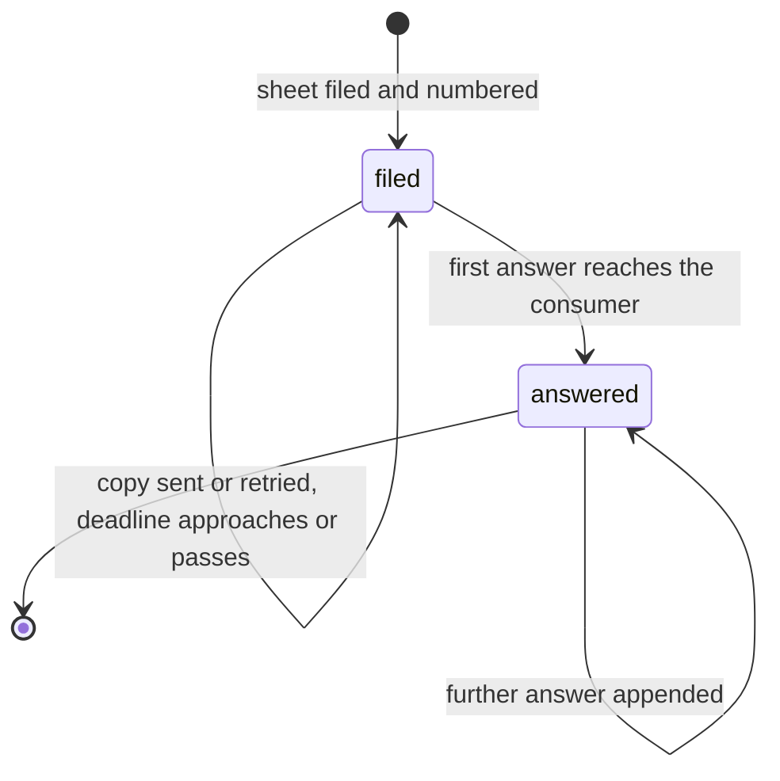

# Complaint state machine

The lifecycle of a Hoja de Reclamación in the Libro de Reclamaciones, as decided in [ADR 0006](../adr/0006-complaints-book.md) (proposed, pending owner review). The state is derived from write-once facts of the complaints module and never stored. Overdue is a condition of an open sheet, not a state: an overdue sheet still has to be answered.

## States

| State | Label (admin) | Kind | Holds when |
|---|---|---|---|
| `filed` | "Registrado" | Initial | The sheet is stored with its number and no answer has reached the consumer (`answered_at` is null) |
| `answered` | "Respondido" | Final | An answer reached the consumer (`answered_at` is set) |

## Conditions

Derived from the same facts. They drive the admin badges and the alerts, never the state.

| Condition | Label (admin) | Holds when |
|---|---|---|
| `copy_pending` | "Copia pendiente" | `copy_sent_at` is null |
| `due_soon` | "Por vencer" | The sheet is `filed` and 5 business days or fewer remain until `response_due_date` (0 on the due date) |
| `overdue` | "Vencido" | The sheet is `filed` and today in Lima is after `response_due_date` |
| `answer_delivery_pending` | "Respuesta por enviar" | An email answer exists with `communicated_at` null |
| `answered_late` | "Respondido fuera de plazo" | The sheet is `answered` and `answered_at` in Lima is after `response_due_date` |

## Transitions

| From | To | Trigger | Guard |
|---|---|---|---|
| — | `filed` | `POST /store/complaints` runs `fileComplaintWorkflow`. The module's `file` method commits the counter and the sheet in one transaction | Valid sheet (F1 rules), ubigeo codes resolve, `declaration_accepted` is true, `submission_id` not used before, within the throttle limits |
| `filed` | `answered` | Email channel: `answerComplaintWorkflow` sends the answer and the notification `status` is `success` | The answer's channel is the consumer's `response_channel`; the body is not empty |
| `filed` | `answered` | Carta channel: the owner records the answer with the date the letter was delivered | Same as above, and the date is in Lima, not before the filing date and not in the future |

No transition leaves `answered`, and no transition returns to `filed`.

## Email delivery

The copy and every email answer follow the same steps. Delivery is tracked per sheet (`copy_sent_at`, `copy_attempts`) and per answer (`communicated_at`, `delivery_attempts`).

| Step | Rule |
|---|---|
| Claim | Increment the attempt counter only if the message is not sent yet and the counter still holds the value read. Only the winner sends |
| Send | Notification Module, channel `email`, `idempotency_key` `complaint-copy:<complaint id>:<attempt>` or `complaint-answer:<answer id>:<attempt>` |
| Success | Set `copy_sent_at`, or set `communicated_at` and, the first time, `answered_at` |
| Failure | Leave the timestamp null. `retry-complaint-copies` tries again every 15 minutes, up to 8 attempts |
| Give up | After the 8th failure, alert the owner once. The owner can resend from the admin at any time |

## Events that do not change the state

- **Copy sent.** Clears `copy_pending`.
- **Copy attempt fails.** The sheet stays `copy_pending` and the retry job tries again.
- **Email answer recorded but not delivered.** The sheet stays `filed` with `answer_delivery_pending` until a send succeeds.
- **Deadline approaches or passes.** `due_soon`, then `overdue`. The sheet stays `filed` and the alerts continue until it is answered.
- **Further answer after `answered`.** It is appended; `answered_at` keeps the first date.
- **Same `submission_id` submitted again.** The route returns the same sheet; nothing is filed or sent.
- **Second sheet about the same facts.** It is a new sheet with its own number and its own deadline.

## Never

- The sheet content and `response_due_date` never change. The deadline is never extended or suspended.
- Sheets and answers are never deleted: at least 2 years, and no automatic deletion in the MVP.
- No `withdrawn`, `canceled` or `discarded` state: every filed sheet gets an answer.

## Side effects

- `complaint.filed`, emitted by `emitEventStep` after `fileComplaintWorkflow` succeeds: a subscriber alerts the owner.
- Filing: the route runs `sendComplaintCopyWorkflow` right away. The consumer receives "Copia de tu Hoja de Reclamación 000000012-2026".
- `retry-complaint-copies` (every 15 minutes): resends pending copies and pending email answers.
- `complaint-deadline-alerts` (daily, 08:00 Lima): alerts at 5 and 2 business days left, on the due date, and every day while overdue.
- Email answer: the consumer receives "Respuesta a tu Hoja de Reclamación 000000012-2026".
- Alerts carry the number, kind and dates only, never personal data.
