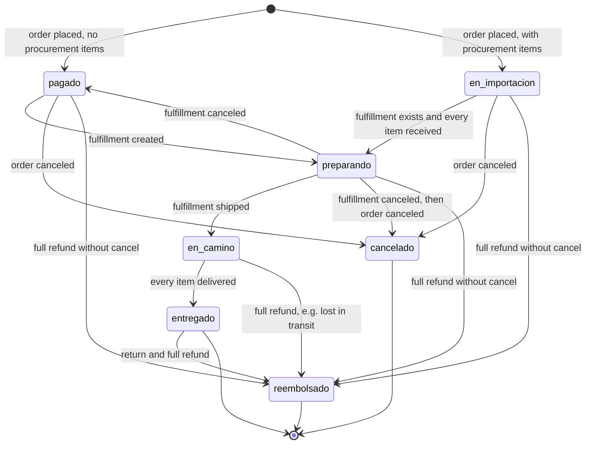

# Order state machine (customer status)

The status customers see on tracking, in their account and in emails. It is computed by the projection in [ADR 0003](../adr/0003-order-status-projection.md) and never stored. The transitions below are the facts in Medusa or in the procurement module that move the projection.

## States

| State | Label | Kind |
|---|---|---|
| `pagado` | "Pagado" | Initial |
| `en_importacion` | "En importación" | Progress, only for orders with procurement items |
| `preparando` | "Preparando tu pedido" | Progress |
| `en_camino` | "En camino" | Progress |
| `entregado` | "Entregado" | Final, unless fully refunded later |
| `cancelado` | "Cancelado" | Final |
| `reembolsado` | "Reembolsado" | Final |

## Transitions

| From | To | Trigger | Guard |
|---|---|---|---|
| — | `pagado` | `completeCartWorkflow` creates the order (`order.placed`) | Payment authorized; the order has no procurement items |
| — | `en_importacion` | `completeCartWorkflow` creates the order; a subscriber on `order.placed` creates its procurement items | At least one line needs procurement (ADR 0007) |
| `pagado` | `preparando` | The owner creates a fulfillment in the admin | — |
| `en_importacion` | `preparando` | The last procurement item is received, or the fulfillment is created, whichever comes last | A fulfillment that is not canceled exists and every procurement item that is not canceled is received |
| `preparando` | `pagado` | The owner cancels the only fulfillment before shipment | No other fulfillment that is not canceled. Every procurement item is already received, so the order does not return to `en_importacion` |
| `preparando` | `en_camino` | The owner creates the shipment (`shipped_at` set) | — |
| `en_camino` | `entregado` | The owner marks the fulfillment delivered | `fulfillment_status` is `delivered` (a partial delivery stays `en_camino`) |
| `pagado`, `en_importacion` | `cancelado` | `cancelOrderWorkflow` (`order.canceled`) | No fulfillment that is not canceled; captured payments are refunded by the workflow |
| `preparando` | `cancelado` | The owner cancels the fulfillment, then the order | Same as above |
| `en_camino` | `reembolsado` | `refundPaymentWorkflow` refunds the rest of the captured amount, for example when the carrier lost the order | The order is not canceled; refunded total equals captured total |
| `entregado` | `reembolsado` | A return, then `refundPaymentWorkflow` refunds the rest of the captured amount | Same as above |
| `pagado`, `en_importacion`, `preparando` | `reembolsado` | `refundPaymentWorkflow` refunds the rest of the captured amount without canceling the order | Same as above. Not the intended path: before shipment the owner cancels the order (`cancelado`). Open procurement items stay open, because no `order.canceled` event fires; the owner cancels them |

## Events that do not change the status

- **Partial refund.** It adds a line to the refunds list; the status stays.
- **Fulfillment created before the goods arrive.** The order stays `en_importacion` until every procurement item is received.
- **Partial delivery.** The order stays `en_camino`.

## Side effects

- `order.canceled`: a subscriber cancels the order's open procurement items (procurement item state machine, T6).
- Any email that reports a status reads the same projection, so emails never disagree with tracking.
