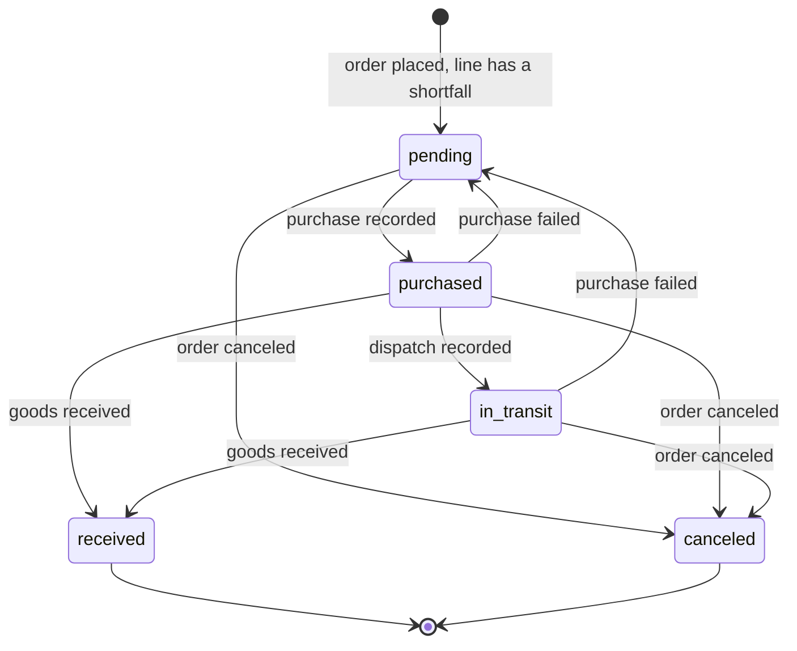

# Procurement item state machine

A procurement item is the purchase of one order line that the store cannot serve from its stock. It is created when the order is placed and ends `received` or `canceled`. [ADR 0007](../adr/0007-availability-mapping.md) decides which lines need one and where the promised lead time comes from. [ADR 0008](../adr/0008-regime-flags.md) decides which suppliers the regime allows. The [order status projection](../adr/0003-order-status-projection.md) reads these items to show `en_importacion` and to move the order to `preparando` (see the [order state machine](../state-machines/order.md)). Status: proposed, pending owner review. The names `received` and `canceled` are fixed by ADR 0003.

## States

| State | Meaning | Kind |
|---|---|---|
| `pending` | Waiting to be bought from the supplier | Initial |
| `purchased` | Bought from the supplier; landed cost recorded | Progress |
| `in_transit` | The supplier or importer has dispatched the goods | Progress, optional |
| `received` | The goods are at the store's stock location | Final |
| `canceled` | No longer needed for the order | Final |

## Transitions

| From | To | Trigger | Guard | Order status |
|---|---|---|---|---|
| — | `pending` | `completeCartWorkflow` places the order (`order.placed`); a subscriber runs `createProcurementItemsWorkflow` | The line's variant has a shortfall at the store location (ADR 0007, point 8). One item per order line; a retried event creates nothing new | `en_importacion` from the order's `created_at` |
| `pending` | `purchased` | The owner records a supplier purchase that includes the item (`recordSupplierPurchaseWorkflow`) | The supplier is allowed by the current regime. The purchase has its comprobante reference, its totals and, when its currency is not PEN, an FX snapshot | Stays `en_importacion` |
| `purchased` | `in_transit` | The owner records the dispatch (`recordDispatchWorkflow`) | — | Stays `en_importacion` |
| `purchased`, `in_transit` | `received` | The owner records the reception (`receiveProcurementItemsWorkflow`) | The whole quantity arrived. A partial delivery leaves the item where it is | `preparando` once every item that is not canceled is received and a fulfillment that is not canceled exists; otherwise stays `en_importacion` |
| `purchased`, `in_transit` | `pending` | The owner records that the purchase failed: the supplier cannot deliver (`failSupplierPurchaseWorkflow`) | The order is not canceled. The failed purchase stays on record | Stays `en_importacion` |
| `pending`, `purchased`, `in_transit` | `canceled` | `cancelOrderWorkflow` (`order.canceled`); a subscriber runs `cancelProcurementItemsWorkflow` | The item is not received | Already `cancelado` |

A `received` item never changes again. Canceling its order releases the goods as ordinary stock. An item cannot be canceled on its own while its order stays open. Without a partial cancellation, the order would show progress for a line that will never arrive. To drop a line, the owner cancels the order. Partial order edits are not in the MVP.

## Events that do not change the state

- **Maximum wait reached.** An item has stayed `pending` longer than its supplier's maximum wait (purchase policy, #28). The daily job `procurement-deadlines` emits `procurement-item.max-wait-reached`, and the owner is told to buy now even below the supplier's minimum.
- **Overdue.** An item is neither `received` nor `canceled` after its `expected_by`: the order's `created_at` plus the promised maximum lead time, in Lima business days.
  - `procurement-deadlines` emits `procurement-item.overdue` once and records `overdue_notified_at`.
  - The customer gets an email (DRAFT copy): "Tu pedido se está demorando. Tu proveedor todavía no nos entrega {producto}. Ahora estimamos que llegue el {fecha}. Si prefieres no esperar, responde este correo y cancelamos tu pedido con el reembolso completo."
  - The order stays `en_importacion`.
- **Landed cost corrected.** A freight or duty invoice that arrives later updates the purchase totals and the item's landed cost until the item is received. A recorded FX snapshot is never rewritten.
- **Fulfillment created before the goods arrive.** The item does not change. The order stays `en_importacion` (ADR 0003).

## Side effects

| Transition | Effect |
|---|---|
| Created | Copies the promise from the chosen supplier offer: `supplier_offer`, `supplier`, `quantity`, `lead_time_min_days`, `lead_time_max_days`, `expected_by`. Emits `procurement-item.created` |
| `purchased` | Links the item to its `SupplierPurchase`. The purchase stores the supplier's comprobante, its totals and, for another currency, the FX snapshot `{ rate, source, capturedAt }` with the rate as a big number (ADR 0001, point 7). The item gets its landed unit cost: price plus its share of freight, duties and importer fee, split by goods cost. The purchase counts toward the Nuevo RUS purchases cap (ADR 0008). Adds the quantity to `incoming_quantity` at the store location. Emits `procurement-item.purchased` |
| `in_transit` | Records `dispatched_at` and the supplier's tracking reference. Emits `procurement-item.dispatched` |
| `received` | Records `received_at`. Adds the quantity to `stocked_quantity` at the store location and removes it from `incoming_quantity`, so the order's fulfillment finds the stock. Emits `procurement-item.received` |
| Purchase failed | Unlinks the item from the failed purchase, which keeps `failed_at`. Removes the quantity from `incoming_quantity`. A refund or credit note from the supplier is recorded on that purchase. Emits `procurement-item.purchase-failed` |
| `canceled` | Records `canceled_at` and `cancel_reason` (`order_canceled`). Emits `procurement-item.canceled`. When the item was already bought, the goods still arrive: the owner records their arrival on the supplier purchase, they become stock, and the item stays `canceled` |

- `order.placed` and `order.canceled` are Medusa events ([Events reference](https://docs.medusajs.com/resources/references/events)). The `procurement-item.*` events are this module's own. The notifications work decides which of them email the customer, apart from the overdue email above.
- Order emails read the order status projection, so they never disagree with tracking.
- Whether Medusa uses `incoming_quantity` in its own stock checks: Not verified; F3 spike.
- Whether a fulfillment can be created while `stocked_quantity` is below the reserved quantity: Not verified; F3 spike. Reception adds the stock first, so the normal path does not depend on the answer.
